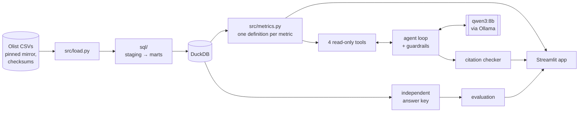

# AI Business Investigation Analyst

**Why did the late-delivery rate go up this month? Which sellers, regions or product categories contributed most, and
what should we investigate first?**

This project answers that question on 100k real orders from Olist, a Brazilian e-commerce marketplace. It has three
parts: a tested SQL data model, a dashboard with transparent anomaly rules, and an AI agent that investigates by
calling read-only analysis tools. Every number in the agent's report is linked to the query that produced it, and the
agent is measured against a plain AI summary on 25 questions with independently computed answers.

Everything runs locally and for free: DuckDB, Streamlit, and an open model (`qwen3:8b`) served by Ollama.

## Results

On 25 questions with independently computed answers, using the same free local model (`qwen3:8b`) for both:

| | Agent (tools + evidence) | Plain AI summary of the dashboard |
|---|---|---|
| Facts correct | **92%** (172/186) | 59% (110/186) |
| Questions fully correct | **15 / 25** | 1 / 25 |
| Numbers traceable to the data | **100%** (427/427), each citing the right evidence | 94%: 21 numbers calculated or made up |
| Incomplete or missing months answered "insufficient evidence" | **6 / 6** | 3 / 6, and reported late rates in 5 |
| Median time per question | 80 s | 19 s |
| Cost | $0 | $0 |

Both systems read the headline numbers equally well. The agent's advantage is everything a dashboard summary can't
see: whether the change is beyond noise, slower deliveries vs shorter promises, and which states drove it. Its weak
spot is judgement: it names the larger of the two effects in only 9 of 15 cases. Details:
[docs/evaluation.md](docs/evaluation.md).

## What it found

Using March 2018 (the late rate rose from 14.1% to 19.0%) as the worked example
([full investigation](docs/investigation_2018_03.md)):

- **About two-thirds of the rise came from shorter delivery promises, not slower deliveries.** The promised window
  shrank from 25.2 to 22.7 days on average while actual delivery time barely moved. Re-scoring both months against
  February's promise per state splits the +4.84 pp change into 1.5 pp from slower deliveries and 3.34 pp from shorter
  promises.
- **It was performance, not mix.** Orders did not shift toward regions that were already late; the same regions got
  worse. Minas Gerais contributed the most (+1.49 pp) by customer state, and São Paulo the most by seller state.
- **Investigate first:** what changed in how estimated delivery dates were set from mid-February 2018, and whether
  the shorter promises were intended. Second, the delivery slowdown that peaked in the week of 26 February.

The same method, run for Black Friday 2017, shows the opposite pattern: the whole +8.2 pp rise was slower deliveries.

## How it works



| Decision | Why it matters |
|---|---|
| **One row per order** before anything is summed | Joining payments to items naively counts revenue twice: R$20.31M instead of R$15.85M (+28%). Tests check every total against the source. |
| **Complete months only** (≥500 orders, ≤5% still open, ≤1% estimates past the data cutoff) | Recent months look on time only because their late orders have not arrived yet. |
| **Mix vs performance** (shift-share decomposition) | Separates "orders moved to regions that were already slow" from "regions got slower". The parts add up exactly to the change. |
| **Slower deliveries vs shorter promises** | "Late" means delivered after the promised date, so the rate can rise because deliveries got slower *or* because promises got shorter. |
| **Anomaly rules anyone can read** | A segment is flagged only with ≥30 orders in both months, \|z\| ≥ 2 and a change of ≥3 pp. |
| **The model never writes SQL or does arithmetic** | Tools take fixed arguments, return pre-computed numbers, and log each call as evidence `E1`, `E2`, … with its exact SQL. |
| **Guardrails in code, not just in the prompt** | The agent is sent back if it skips required steps; a report whose numbers don't match their cited evidence gets one repair round; incomplete months return "insufficient evidence" instead of rates. |

Every decision is written up with alternatives in [docs/decisions.md](docs/decisions.md); the architecture is in
[docs/design.md](docs/design.md).

## Run it

Requires macOS or Linux, [uv](https://docs.astral.sh/uv/) and about 1 GB of disk. No accounts or API keys.

```bash
git clone https://github.com/savithasundaresan/ai-investigation-analyst.git
cd ai-investigation-analyst
uv sync
uv run python -m src.load          # fetches the data (~65 MB, checksum-verified) and builds the database
uv run pytest                      # data integrity, metrics, agent and evaluation tests
uv run streamlit run app/Dashboard.py
```

The app opens at http://localhost:8501 with three pages:

- **Dashboard:** KPIs, trends, both decompositions and flagged segments, each with a "Show SQL" expander.
- **Investigate:** replay a saved agent run (no model needed) or run one live.
- **Evaluation:** agent vs baseline, question by question.

To run the agent live, install [Ollama](https://ollama.com), then:

```bash
ollama pull qwen3:8b                # about 5 GB, once
uv run python -m src.agent --base 2018-02 --current 2018-03
```

Optional: `uv sync --extra claude` and `LLM_PROVIDER=anthropic` with an `ANTHROPIC_API_KEY` swaps in Claude. The
provider layer (`src/llm.py`) is the only code that talks to a model.

Re-score the evaluation from the saved runs (no model needed), or re-run it (about an hour locally):

```bash
uv run python -m src.evaluate score
uv run python -m src.evaluate run --force
```

## Repository

```
app/            Dashboard.py, pages/2_Investigate.py, pages/3_Evaluation.py
sql/            staging → intermediate → marts
src/            load, metrics, tools, agent, llm, report (citation checker), evaluate, answer_key
tests/          86 tests: totals match the source, decompositions add up, checker, agent replay, answer key
eval/           saved agent and baseline runs, results.json
replays/        saved agent runs shown on the Investigate page
docs/           plan, decisions, design, data profile, investigation, evaluation, case study, demo script
```

## Limitations

- Historical data (2016–2018), replayed as if each month were current.
- The data shows what changed together, not why. Reports say "associated with", and the recommendations are things
  to investigate, not proven causes.
- A small local model writes the reports. It reliably copies numbers correctly but is weaker at judgement, such as
  saying which of two effects was larger. The evaluation measures this.
- Evaluation facts are checked by written text rules, which are strict: a fact counts only if the report states it
  plainly.

Data: [Olist Brazilian E-Commerce Public Dataset](https://www.kaggle.com/datasets/olistbr/brazilian-ecommerce)
(CC BY-NC-SA 4.0), loaded from a pinned public mirror with SHA-256 checksums.
