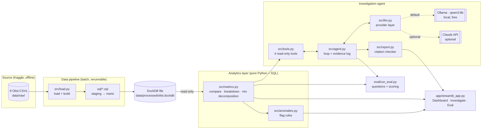
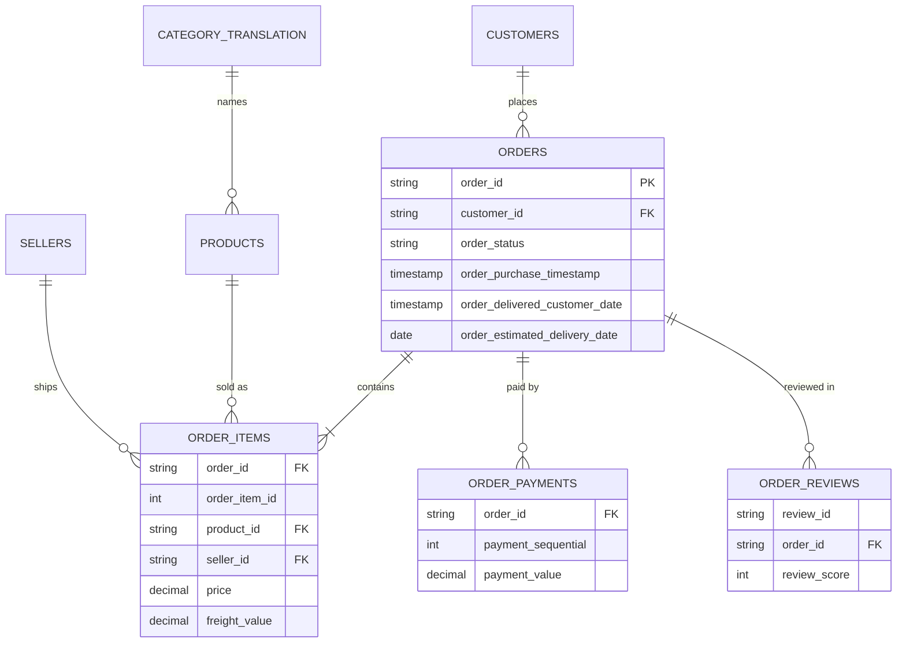
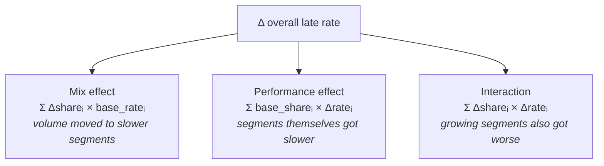
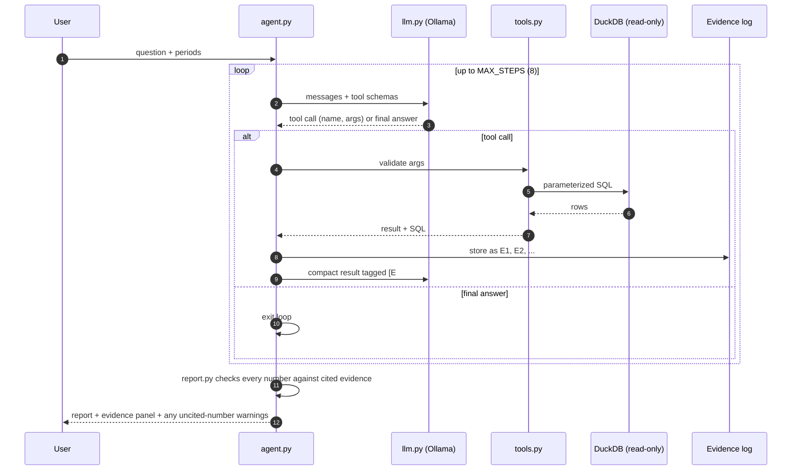
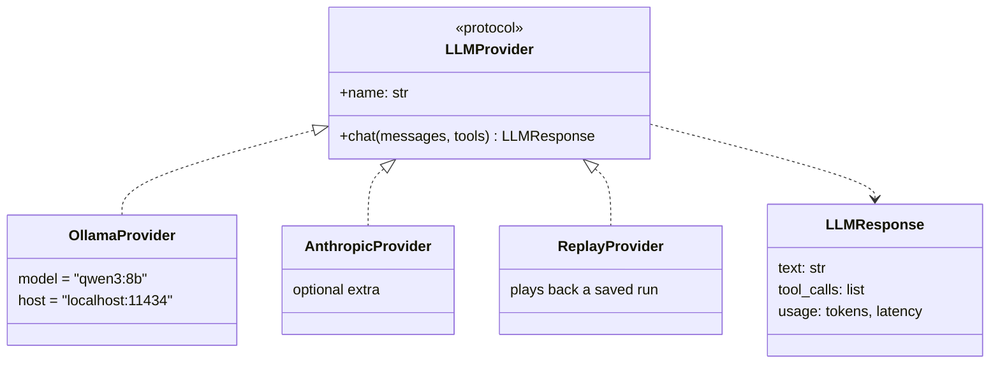

# Design: AI Business Investigation Analyst

> Status: v1 design, written before implementation. Sections marked
> *(to verify)* depend on profiling the real data in Stage 1.

## 1. Goal

Answer one business question with numbers that can be checked:

> "Why did the late-delivery rate go up this month? Which sellers, regions or
> product categories contributed most, and what should we investigate first?"

**Goals**
- A data model where every metric is defined once, in SQL, and tested.
- A dashboard that shows the problem, with anomaly rules anyone can read.
- An agent that investigates by calling a few read-only tools and writes a
  report in which every number is traced back to the query that produced it.
- An evaluation that proves (or disproves) that the agent beats a plain AI summary.

**Non-goals (v1):** deployment, logins, live data, forecasting, letting the
LLM write arbitrary SQL.

## 2. System overview



**Key design rule:** the dashboard, the agent's tools and the evaluation all
call the *same* functions in `src/metrics.py`. A metric can't mean one thing
on the dashboard and another in the agent's report.

## 3. Data model

### 3.1 Source tables (as delivered by Olist)



The geolocation table is not used in v1. Region means the customer's or
seller's state.

### 3.2 Layers

| Layer | Prefix | Grain | Purpose |
|---|---|---|---|
| Raw | `raw_` | as in the CSV | exact copy of the source, never edited |
| Staging | `stg_` | as in the CSV | types, renamed columns, English category names, text trimmed |
| Intermediate | `int_` | **1 row per order** | items, payments and reviews each collapsed to one row per order *before* joining (decision D1) |
| Marts | `fct_`, `bridge_`, `dim_` | stated per table | the only tables the app and agent read |

### 3.3 Mart tables

| Table | Grain | Main columns |
|---|---|---|
| `fct_orders` | 1 row per order | status, purchase month, customer state, `is_delivered`, `is_late`, `days_late`, `delivery_days`, `order_value`, `review_score`, `is_low_review`, `n_items`, `n_sellers` |
| `bridge_order_segment` | 1 row per order × seller × category | `seller_id`, `seller_state`, `category`, `item_value`, used for seller/category breakdowns |
| `dim_month` | 1 row per purchase month | order count, share still undelivered, `is_complete` flag (decision D3) |

Order-level outcomes (`is_late`, `review_score`) live only on `fct_orders`.
Breakdowns join `bridge_order_segment` to `fct_orders` and use
`COUNT(DISTINCT order_id)`, so an order split across two sellers is counted
once for each seller but never twice for the same one.

## 4. Metric definitions

| Metric | Numerator | Denominator | Notes |
|---|---|---|---|
| Order volume | orders purchased | — | all statuses |
| **Late-delivery rate** | delivered orders where delivery date > estimated date | delivered orders with a delivery date | compared on calendar date (D2) |
| Avg days late | Σ days late | late orders | severity, not just frequency |
| Order value (AOV) | Σ payment value | orders with a payment | payments summed per order first |
| Low-review rate | orders with review score ≤ 2 | orders with a review | latest review if several *(to verify)* |
| Cancellation rate | canceled or unavailable orders | all orders | tracked separately, never counted as late |

## 5. Analytics layer

### 5.1 Core functions (`src/metrics.py`)

| Function | Returns |
|---|---|
| `kpis(period, filters)` | the metrics above for one period |
| `trend(metric, filters)` | the metric for each month |
| `compare_periods(metric, base, current, filters)` | both values, the change, and a two-proportion z-score |
| `break_down(metric, dimension, base, current)` | per segment: n, rate, share, change, z, sample-size flag |
| `decompose_mix(metric, dimension, base, current)` | the mix / performance / interaction split, total and per segment |

Each function returns a `Result`: a data frame plus the exact SQL text and
its parameters. That pair is what the agent cites as evidence.

### 5.2 Mix vs performance decomposition (decision D5)



The three parts add up exactly to the total change, and a unit test checks
that. Segments below the minimum sample size are grouped into an "Other"
bucket, so their noisy rates don't dominate either effect.

### 5.3 Anomaly rules (`src/anomalies.py`, decision D6)

A segment is flagged when **all three** hold:
1. `n ≥ MIN_N` delivered orders in both periods (default 30)
2. `|z| ≥ 2` on the change in late rate
3. `|Δ rate| ≥ MIN_PP` percentage points (default 3)

These thresholds live in one config block and are shown next to every flag.

## 6. Investigation agent

### 6.1 Tools (all read-only, all parameterized)

| Tool | Wraps | Typical use |
|---|---|---|
| `check_data_quality(period)` | completeness, null dates, status mix | always first: is the month comparable at all? |
| `compare_periods(metric, base, current, filters)` | `metrics.compare_periods` | confirm the headline change |
| `break_down_metric(metric, dimension, base, current)` | `metrics.break_down` + `decompose_mix` | find which segments drove it and whether it's mix or performance |
| `inspect_orders(filters, limit)` | sample rows from `fct_orders` | look at concrete examples in a suspicious segment |

The LLM never writes SQL. It fills in arguments from fixed lists (metric
names, dimensions, months), and the tool validates them before running
anything. The DuckDB connection is opened `read_only=True`.

### 6.2 Agent loop



### 6.3 Investigation playbook (in the system prompt)

1. **Data quality first.** If either month is incomplete, or too few orders
   were delivered, say so and stop or qualify every finding that follows.
2. **Confirm the headline change** and whether it's beyond noise.
3. **Decompose by dimension** (seller, seller state, customer state,
   category), separating mix from performance.
4. **Drill into the top contributors** with `inspect_orders`.
5. **Write the report:** findings → numbers [E#] → what to investigate
   first → limitations. Say "association, not causation". Say "insufficient
   evidence" when the rules aren't met. No invented savings, and no claims
   that any action was taken.

### 6.4 Evidence and citations (`src/report.py`)

- Every tool result gets an ID (`E1`, `E2`, …) and is stored with its SQL,
  parameters, row count and timestamp.
- The report must attach `[E#]` to every number.
- A checker pulls each number out of the report and verifies that it appears
  (after rounding) in the cited evidence. Numbers that fail the check are
  highlighted in the UI and counted in the evaluation.

### 6.5 LLM provider layer (`src/llm.py`, decision D9)



`ReplayProvider` lets the GitHub demo and the tests run with no model at all.

## 7. Streamlit app

| Tab | Contents |
|---|---|
| **Dashboard** | KPI tiles (current vs base month), monthly trend, breakdown table with anomaly flags, filters for period / seller state / customer state / category. Banner: *Simulation: historical replay*. |
| **Investigate** | Question box, model selector (Ollama / replay / optional Claude), live tool-call timeline, report with clickable `[E#]` links that expand the SQL and its result. |
| **Evaluation** | The latest scorecard: agent vs baseline, accuracy, citation support, tool failures, latency. |

## 8. Evaluation design

- `eval/questions.json`: 20–30 questions, each with a hand-written answer SQL
  in `eval/answers/*.sql`. Includes missing-data cases (incomplete months),
  insufficient-evidence cases (tiny segments) and mix-vs-performance cases.
- **Systems compared:** (a) the agent; (b) a baseline: the same model given
  dashboard KPIs as text, with no tools.
- **Metrics:**
  - numerical accuracy: within tolerance of the SQL answer
  - evidence support: % of numbers that passed the citation check
  - correct "insufficient evidence" calls
  - tool errors
  - response time
  - cost ($0 locally; tokens are logged)
- Output: `eval/results/<date>.json` plus a Markdown summary for the README.

## 9. Repository layout

```
ai-investigation-analyst/
├── app/streamlit_app.py
├── data/raw/                # Kaggle CSVs (git-ignored)
├── data/processed/          # olist.duckdb (git-ignored, rebuilt by load.py)
├── docs/                    # plan, decisions, design, case study, demo script
├── eval/                    # questions, answer SQL, runner, results
├── sql/                     # 01_staging.sql … 04_marts.sql
├── src/
│   ├── load.py   db.py   metrics.py   anomalies.py
│   ├── tools.py  llm.py  agent.py     report.py
│   └── config.py            # thresholds, model, paths
└── tests/                   # data integrity, metrics, decomposition, citation checker
```

## 10. Risks and mitigations

| Risk | Mitigation |
|---|---|
| Join fan-out inflates totals | `int_` layer has one row per order; tests compare totals with the source |
| Recent months look good only because late orders haven't been delivered yet | `dim_month.is_complete`; incomplete months are excluded or flagged |
| Small segments produce extreme rates | `MIN_N`; "Other" bucket; z-test |
| Small local model picks the wrong tool or makes up numbers | fixed argument lists, max steps, citation checker, measured in the evaluation |
| Agent confuses association with causation | playbook rule plus a report template with a fixed "Limitations" section |
| Slow local inference during a live demo | replay mode |
